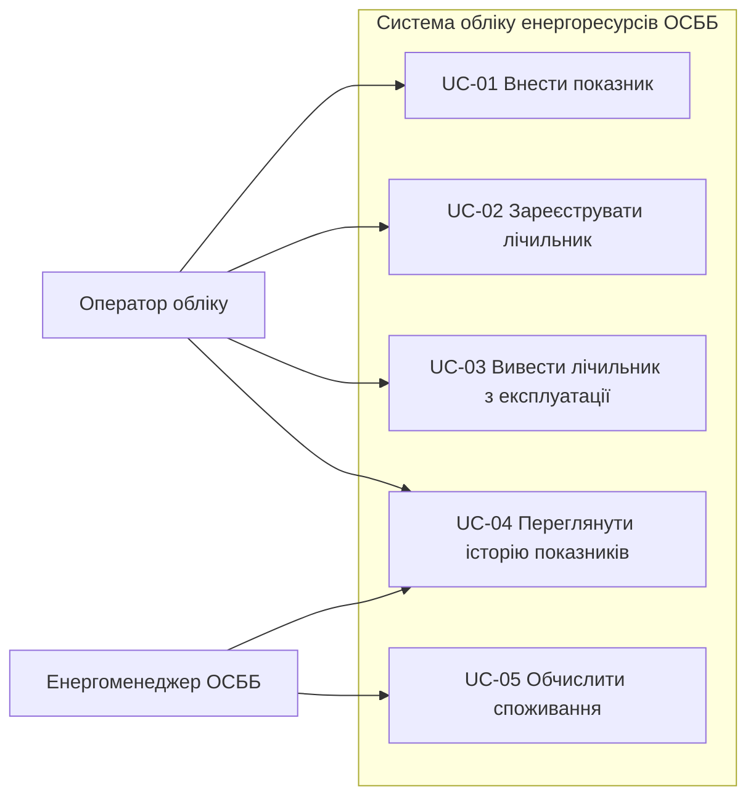
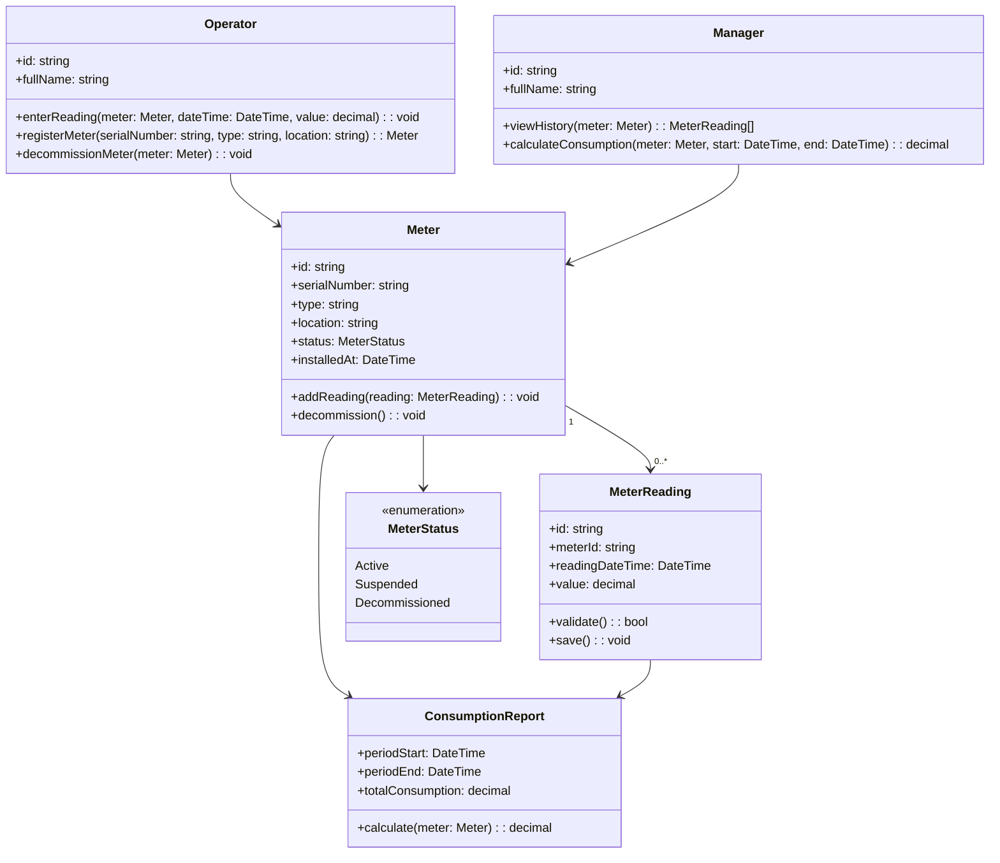
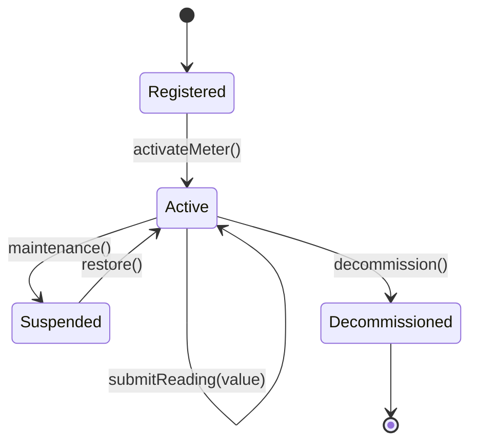

# Проєктна модель v1.0

## 1. Use Case Diagram

## 2. Class Diagram

## 3. State Machine Diagram

У цьому варіанті станів лічильник має життєвий цикл: зареєстрований → активний → призупинений/виведений з експлуатації. Така діаграма необхідна, бо наявна логіка зміни стану лічильника впливає на правила внесення показників.
