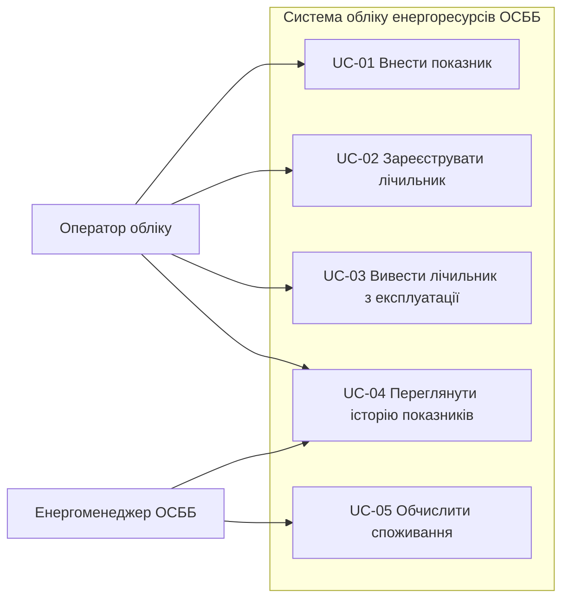
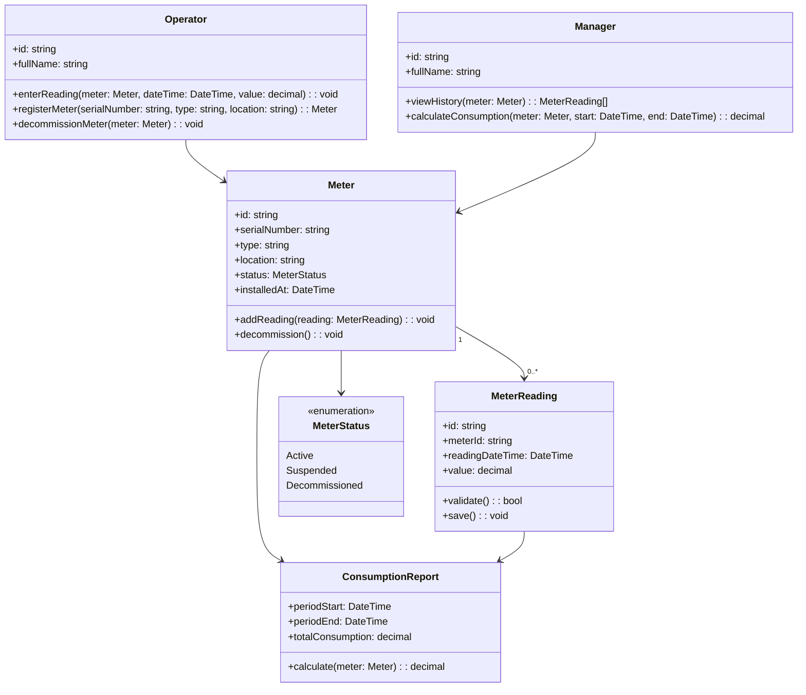
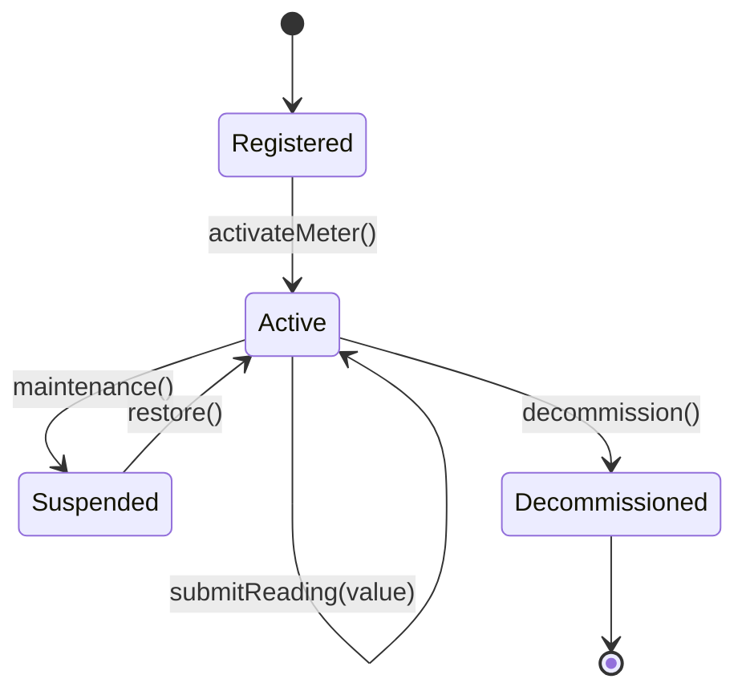

# Проєктна модель та фактична структура v1.0

## 1. Use Case Diagram



## 2. Початкова проєктна модель (з ЛР №3)



## 3. State Machine Diagram



У цьому варіанті станів лічильник має життєвий цикл: зареєстрований → активний → призупинений/виведений з експлуатації. Така діаграма необхідна, бо наявна логіка зміни стану лічильника впливає на правила внесення показників.

---

## 4. Командна діаграма класів фактичної реалізації v1.0.0

Нижче наведено фактичну архітектуру C# компонентів рішення `Labka`, отриману в результаті зворотного проєктування (reverse engineering). Вона відображає серверну частину (Web API), предметні моделі, сервіси пам'яті з синхронізацією `lock`, DTO/контракти та консольний клієнт (`Labka.Client`).

```mermaid
classDiagram
    direction TB

    namespace Models {
        class Meter {
            +Guid Id
            +string SerialNumber
            +string Type
            +string Location
            +MeterStatus Status
            +DateTimeOffset InstalledAt
            +decimal Coefficient
        }

        class MeterReading {
            +Guid Id
            +Guid MeterId
            +DateTimeOffset RecordedAt
            +decimal Value
        }

        class MeterStatus {
            <<enumeration>>
            Active
            Suspended
            Decommissioned
        }
    }

    namespace Services {
        class ReadingRules {
            <<static>>
            +ValidValue(decimal value) bool
            +ValidCoefficient(decimal value) bool
            +IsTimeLater(DateTimeOffset newAt, DateTimeOffset previousAt) bool
            +IsValueNotLower(decimal newValue, decimal previousValue) bool
            +CanAccept(DateTimeOffset newAt, decimal newValue, DateTimeOffset prevAt, decimal prevVal) bool
        }

        class IEnergyStore {
            <<interface>>
            +GetAllMeters() IReadOnlyList~Meter~
            +GetMeter(Guid id) Meter?
            +AddMeter(Meter meter) Meter
            +UpdateMeterStatus(Guid id, MeterStatus status) bool
            +GetReadings(Guid meterId, DateTimeOffset? from, DateTimeOffset? to) IReadOnlyList~MeterReading~
            +GetLastReading(Guid meterId) MeterReading?
            +AddReading(Guid meterId, DateTimeOffset recordedAt, decimal value) AcceptReadingResult
            +CalculateConsumption(Guid meterId, DateTimeOffset from, DateTimeOffset to) (bool, string?, string?, ConsumptionDto?)
            +Reset() void
        }

        class InMemoryEnergyStore {
            -object _lock
            -List~Meter~ _meters
            -List~MeterReading~ _readings
            +GetAllMeters() IReadOnlyList~Meter~
            +GetMeter(Guid id) Meter?
            +AddMeter(Meter meter) Meter
            +UpdateMeterStatus(Guid id, MeterStatus status) bool
            +GetReadings(Guid meterId, DateTimeOffset? from, DateTimeOffset? to) IReadOnlyList~MeterReading~
            +GetLastReading(Guid meterId) MeterReading?
            +AddReading(Guid meterId, DateTimeOffset recordedAt, decimal value) AcceptReadingResult
            +CalculateConsumption(Guid meterId, DateTimeOffset from, DateTimeOffset to) (bool, string?, string?, ConsumptionDto?)
            +Reset() void
        }

        class EnergyService {
            -IEnergyStore _store
            +GetAllMeters() IReadOnlyList~MeterDto~
            +GetMeter(Guid id) MeterDto?
            +RegisterMeter(RegisterMeterRequest request) (bool, string?, string?, MeterDto?)
            +DecommissionMeter(Guid id) (bool, string?, string?)
            +SubmitReading(Guid meterId, SubmitReadingRequest request) AcceptReadingResult
            +GetReadings(Guid meterId, DateTimeOffset? from, DateTimeOffset? to) IReadOnlyList~MeterReadingDto~
            +CalculateConsumption(Guid meterId, DateTimeOffset from, DateTimeOffset to) (bool, string?, string?, ConsumptionDto?)
        }
    }

    namespace Contracts {
        class RegisterMeterRequest {
            +string SerialNumber
            +string Type
            +string Location
            +DateTimeOffset? InstalledAt
            +decimal? Coefficient
        }

        class SubmitReadingRequest {
            +DateTimeOffset RecordedAt
            +decimal Value
        }

        class MeterDto {
            +Guid Id
            +string SerialNumber
            +string Type
            +string Location
            +string Status
            +DateTimeOffset InstalledAt
            +decimal Coefficient
        }

        class MeterReadingDto {
            +Guid Id
            +Guid MeterId
            +DateTimeOffset RecordedAt
            +decimal Value
        }

        class ConsumptionDto {
            +Guid MeterId
            +string SerialNumber
            +DateTimeOffset PeriodStart
            +DateTimeOffset PeriodEnd
            +decimal StartValue
            +decimal EndValue
            +decimal Consumption
            +decimal Coefficient
        }

        class ApiError {
            +string Code
            +string Message
        }

        class AcceptReadingResult {
            +bool Accepted
            +string? Code
            +string? Message
            +MeterReadingDto? Reading
        }
    }

    namespace Presentation {
        class Program_API {
            <<ASP.NET Core Web API>>
            +MapGet("/api/meters")
            +MapGet("/api/meters/{id}")
            +MapPost("/api/meters")
            +MapPost("/api/meters/{id}/decommission")
            +MapPost("/api/meters/{id}/readings")
            +MapGet("/api/meters/{id}/readings")
            +MapGet("/api/meters/{id}/consumption")
            +MapGet("/health")
        }

        class Labka_Client {
            <<Console Client>>
            +Main(string[] args)
            +GetAllMetersAsync(HttpClient)
            +RegisterMeterAsync(HttpClient)
            +SubmitReadingAsync(HttpClient)
            +ViewHistoryAsync(HttpClient)
            +CalculateConsumptionAsync(HttpClient)
            +DecommissionMeterAsync(HttpClient)
            +RunAutomatedDemoAsync(HttpClient)
        }
    }

    %% Relationships
    Meter --> MeterStatus : has
    Meter "1" --> "0..*" MeterReading : relates to
    InMemoryEnergyStore ..|> IEnergyStore : implements
    InMemoryEnergyStore o-- Meter : stores in-memory
    InMemoryEnergyStore o-- MeterReading : stores in-memory
    InMemoryEnergyStore ..> ReadingRules : validates using
    EnergyService --> IEnergyStore : depends on
    EnergyService ..> ReadingRules : uses
    Program_API --> EnergyService : invokes
    Labka_Client ..> Program_API : HTTP REST JSON
    EnergyService ..> MeterDto : returns
    EnergyService ..> MeterReadingDto : returns
    EnergyService ..> ConsumptionDto : returns
```

---

## 5. Зіставлення проєктної моделі (ЛР №3) та фактичної реалізації (ЛР №4)

У таблиці нижче наведено порівняльний аналіз між попереднім концептуальним задумом (ЛР №3) та фактичною реалізацією першої версії програми v1.0.0.

| Елемент / Концепція | Проєктна модель (ЛР №3) | Фактична реалізація (ЛР №4) | Обґрунтування / Причина зміни |
| --- | --- | --- | --- |
| **Актори системи (Operator, Manager)** | Змодельовані як класи предметної області з методами (`enterReading`, `registerMeter`) | Реалізовані на стороні клієнта (`Labka.Client`) у вигляді консольного меню та ролей користувача, а на сервері — у вигляді REST API маршрутів | У вебзастосунках обов'язки операцій виносяться в клієнт та контролери/мінімальні API, а користувачі не є класами обробки бізнес-логіки сервера. |
| **Зберігання даних** | Припускалося збереження безпосередньо сутностями (`MeterReading.save()`) | Виділено окремий потокобезпечний сервіс `InMemoryEnergyStore` (з `lock(_lock)`), керований інтерфейсом `IEnergyStore` | Реалізація вимоги 4.3.2 щодо зберігання об'єктів у спільній колекції оперативної пам'яті сервера протягом його роботи та синхронізації доступу між потоками. |
| **Валідація правил** | Метод `MeterReading.validate()` | Виділено чистий статичний клас `ReadingRules` та перевірки всередині `EnergyService` | Відокремлення предметних правил валідації (чиста функція без побічних ефектів) покращує тестованість (27 автоматичних тестів) та спрощує зміну правил. |
| **Ідентифікатори сутностей** | Тип `string` | Тип `Guid` | Забезпечення глобальної унікальності ID для надійного зв'язування лічильників та показників без конфліктів при паралельних запитах. |
| **Формат часових міток** | Тип `DateTime` | Тип `DateTimeOffset` з приведенням до UTC | Виключення проблем із часовими поясами при обміні даними через HTTP/JSON та порівнянні послідовності показників. |
| **Контракти обміну (DTO)** | Відсутні окремі DTO (передбачався обмін сутностями) | Створено окремі рекорди `RegisterMeterRequest`, `SubmitReadingRequest`, `MeterDto`, `MeterReadingDto`, `ConsumptionDto`, `ApiError` | Дотримання контракту програмного інтерфейсу (4.3.1) та безпека даних (клієнт не змінює внутрішній стан сутностей напряму). |
| **Розрахунок споживання** | Клас `ConsumptionReport` | Метод `EnergyService.CalculateConsumption` та запит `GET /api/meters/{id}/consumption` з DTO `ConsumptionDto` | У v1.0 достатньо оперативної операції розрахунку за обраний діапазон дат без потреби створення окремої сутності звіту в пам'яті. |
| **Зв'язки навігації** | Двосторонні посилання `Meter` ↔ `MeterReading` | Односторонній зв'язок за зовнішнім ключем `MeterId` у `MeterReading` | Спрощує серіалізацію в JSON (запобігає циклічним залежностям) та оптимізує фільтрацію показників у колекції. |
