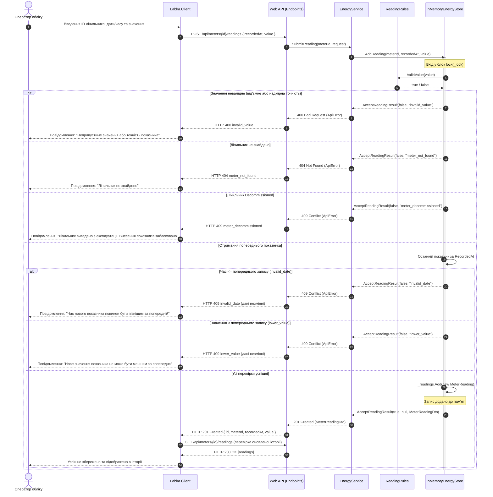

# Діаграма послідовності: UC-01 Внесення показника лічильника

**Автор реалізації:** Ткаченко Богдан  
**Рецензент:** Трофименко Арсеній  
**Пов'язані вимоги:** FR-01, NFR-02, UC-01, AC-01, AC-02, AC-03  

## Опис сценарію

Клієнт (`Labka.Client`) надсилає HTTP POST запит із датою/часом (`recordedAt`) та числовим значенням (`value`) на адресу `/api/meters/{id}/readings`.
Сервер перевіряє наявність лічильника, валідує вхідні значення за правилами `ReadingRules`, звіряє попередній показник лічильника у сховищі `InMemoryEnergyStore`.
Залежно від результатів валідації:
1. Якщо час не пізніший за попередній — повертається помилка 409 `invalid_date`, стан даних залишається незмінним.
2. Якщо значення менше за попереднє — повертається помилка 409 `lower_value`, стан даних залишається незмінним.
3. Якщо лічильник виведено з експлуатації — повертається помилка 409 `meter_decommissioned`, стан даних залишається незмінним.
4. Якщо всі перевірки пройдено — новий запис додається до колекції в пам'яті (захищено блокуванням `lock`), і клієнту повертається статус 201 Created із даними збереженого показника.

## Діаграма послідовності (Mermaid)

