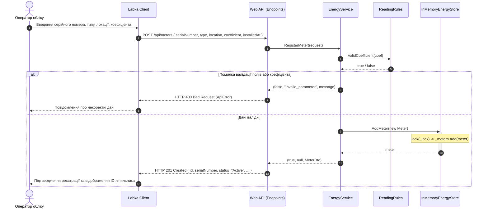

# Діаграма послідовності: UC-02 Реєстрація нового лічильника

**Автор реалізації:** Трофименко Арсеній  
**Рецензент:** Ткаченко Богдан  
**Пов'язані вимоги:** FR-02, UC-02, AC-02  

## Опис сценарію

Клієнт надсилає HTTP POST запит на адресу `/api/meters` із серійним номером, типом ресурсу, локацією встановлення та коефіцієнтом.
Сервер валідує параметри:
1. Якщо серійний номер, тип або локація порожні — повертається помилка 400 Bad Request.
2. Якщо коефіцієнт не є додатним числом — повертається помилка 400 Bad Request.
3. Якщо дані валідні — створюється новий об'єкт `Meter` у стані `Active`, зберігається в сховищі `InMemoryEnergyStore` (під блокуванням `lock`), і клієнту повертається статус 201 Created із DTO зареєстрованого лічильника.

## Діаграма послідовності (Mermaid)

