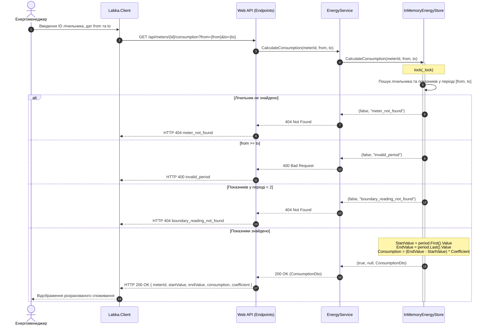

# Діаграма послідовності: UC-05 Обчислення споживання енергоресурсу

**Автор реалізації:** Трофименко Арсеній  
**Рецензент:** Ткаченко Богдан  
**Пов'язані вимоги:** FR-05, UC-05, AC-04  

## Опис сценарію

Енергоменеджер або оператор через клієнт запитує обчислення споживання за вказаний проміжок часу (`from`, `to`).
Сервер виконує:
1. Валідацію дат у форматі ISO 8601 та перевірку `from < to`.
2. Пошук лічильника та показників у заданому інтервалі.
3. Якщо показників менше 2 — повертається помилка 404 `boundary_reading_not_found`.
4. Якщо показники присутні — обчислюється різниця між кінцевим і початковим значенням, помножена на коефіцієнт лічильника: `Consumption = (EndValue - StartValue) * Coefficient`.
5. Клієнту повертається статус 200 OK з `ConsumptionDto`.

## Діаграма послідовності (Mermaid)

