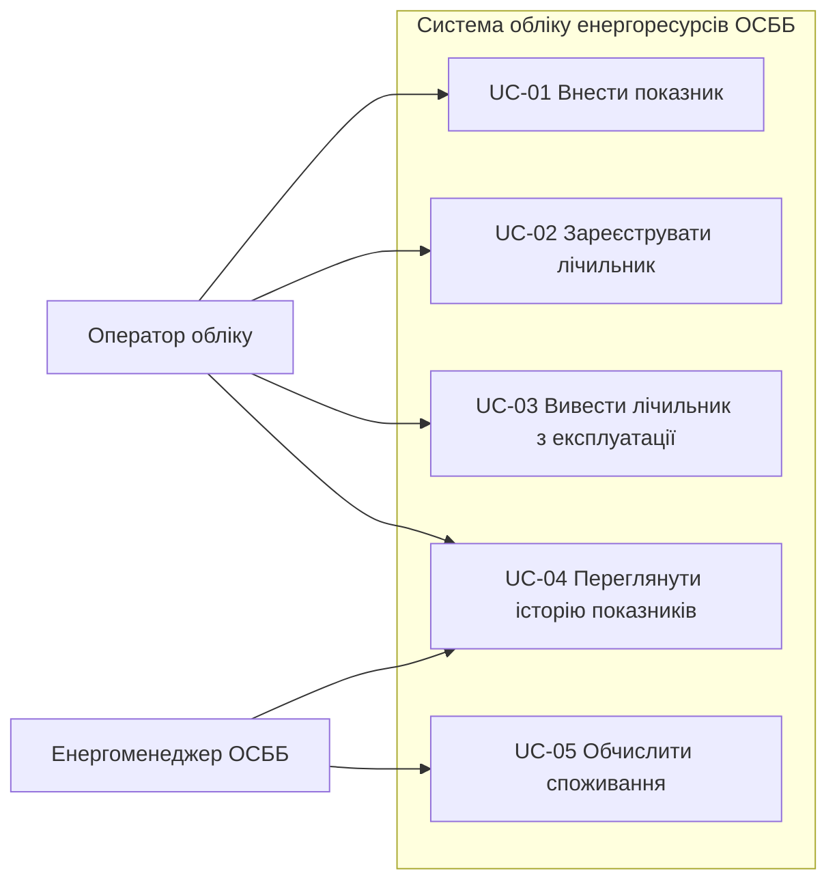
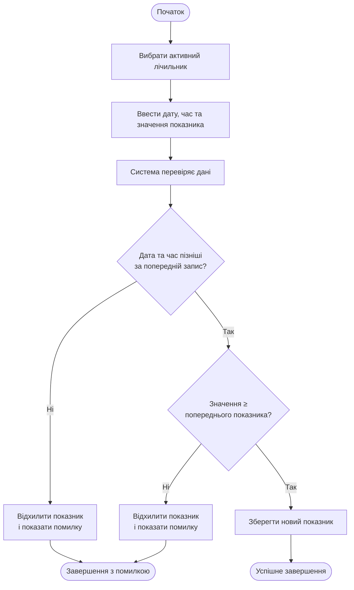

# Use Cases v1.0

## 1. Use Case Diagram

## 2. Детальний Use Case: UC-01 Внести показник

- ID і назва: UC-01 / Внести показник
- Мета: Фіксувати нове значення лічильника для обраного ресурсу.
- Актори: Оператор обліку
- Тригер: Оператор хоче внести або оновити показник лічильника.
- Передумови:
  - Лічильник зареєстрований в системі.
  - Лічильник активний і не виведений з експлуатації.
  - Для лічильника є попередній запис показника.
- Основний успішний сценарій:
  1. Оператор обирає активний лічильник.
  2. Оператор вводить дату, час і нове значення показника.
  3. Система перевіряє, що дата/час пізніші за попередній запис і значення не менше попереднього.
  4. Система зберігає запис показника.
  5. Система показує підтвердження успішного внесення.
- Альтернативні потоки:
  - Якщо дата/час пізніша за попередню, але значення менше або дорівнює попередньому — система відхиляє запис і показує помилку.
  - Якщо дата/час не є більшою за попередню — система відхиляє запис і повідомляє про некоректну послідовність даних.
- Виняткові потоки:
  - Якщо лічильник не знайдено в системі — система виводить повідомлення про відсутність активного лічильника.
  - Якщо введені дані не є числовими або не проходять валідацію — система відхиляє внесення.
- Постумови:
  - У історії лічильника з’являється новий запис.
  - Для подальших розрахунків доступний актуальний показник.
- Пов’язані вимоги: FR-01, NFR-01, NFR-02.

## 3. Activity Diagram для UC-01

